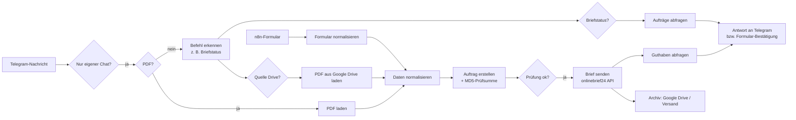
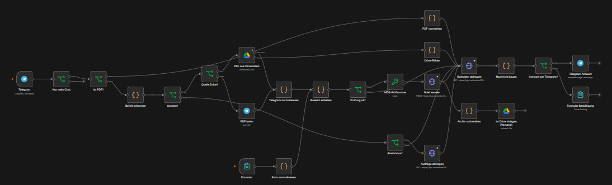
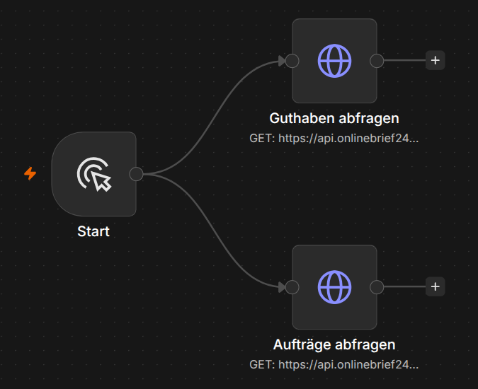

# n8n Telegram Briefversand Bot

> Send real postal letters by dropping a PDF into Telegram – an n8n workflow using the onlinebrief24 API, with Google Drive archiving and balance check.

Briefe per Post verschicken – ohne Drucker, Umschlag und Gang zur Post. PDF an den Telegram-Bot schicken, der Rest läuft automatisch.

## Problem

Kleine Unternehmen und Selbstständige verschicken immer noch regelmäßig Briefe: Angebote, Kündigungen, Behördenpost, Akquise-Anschreiben. Jeder Brief bedeutet drucken, falten, kuvertieren, frankieren und zur Post bringen – und hinterher weiß niemand mehr genau, was wann verschickt wurde.

## Lösung

Ein n8n-Workflow, der den kompletten Versand übernimmt:

1. **PDF hochladen** – per Telegram-Bot oder über ein n8n-Formular
2. **Versand** – das PDF geht über die REST-API von [onlinebrief24](https://www.onlinebrief24.de) in den Druck und wird als echter Brief zugestellt
3. **Archivierung** – jeder verschickte Brief wird automatisch in Google Drive (Ordner `Versand`) abgelegt
4. **Rückmeldung** – der Bot bestätigt den Versand und meldet das verbleibende Guthaben, damit man rechtzeitig aufladen kann

## Ablauf

## Screenshots

**Hauptworkflow – Brief versenden (Telegram + Formular)**

**Hilfsworkflow – Guthaben & Status prüfen**

## Funktionen

- Upload per Telegram, Web-Formular oder direkt aus Google Drive
- Befehle im Chat, z. B. Briefstatus der letzten Aufträge abfragen
- MD5-Prüfsumme sichert die Datei-Integrität vor dem Versand
- Schwarz-Weiß-Druck als Standard, Farbe auf Wunsch
- Automatische Archivierung jedes versendeten PDFs in Google Drive
- Restguthaben nach jedem Versand
- Zugriff nur für freigegebene Telegram-Chat-IDs

## Voraussetzungen

- Selbst gehostete [n8n](https://n8n.io)-Instanz (z. B. per Docker/Coolify)
- Telegram-Bot (über [@BotFather](https://t.me/BotFather) erstellt)
- onlinebrief24-Konto mit API-Zugang
- Google-Drive-Zugang (OAuth2-Credential in n8n)

## Einrichtung

1. Repository klonen und `.env.example` nach `.env` kopieren, Werte eintragen
2. In n8n: **Workflows → Import from File** → `workflows/briefversand.json`
3. Credentials in n8n anlegen und den Nodes zuweisen:
   - Telegram API (Bot-Token)
   - onlinebrief24 (API-Zugangsdaten)
   - Google Drive OAuth2
4. Platzhalter im Workflow ersetzen (siehe `.env.example`)
5. Workflow aktivieren und ein Test-PDF an den Bot schicken

## Sicherheit & Datenschutz

- Keine Zugangsdaten im Repository – alle Secrets liegen in n8n-Credentials bzw. `.env`
- Der Bot reagiert nur auf freigegebene Chat-IDs
- Briefe enthalten personenbezogene Daten: n8n und Archiv sollten auf eigener Infrastruktur in der EU laufen

## Autor

**Ammad Khan** – Prozessautomatisierung & RPA
[miak-it.de](https://miak-it.de) · [GitHub](https://github.com/1a-khan)

## Lizenz

MIT – siehe [LICENSE](LICENSE)
